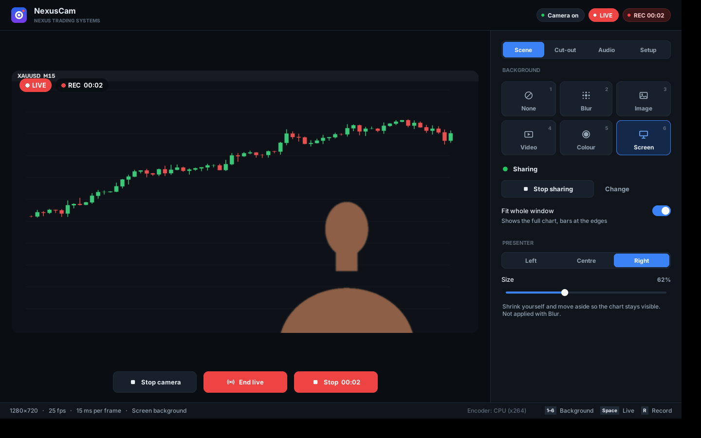

# NexusCam

Live background replacement, virtual webcam and recorder for Linux, built for trading content under **Nexus Trading Systems**.



NexusCam takes your real webcam, cuts you out of the frame, and puts a new background behind you: a blur, an image, a looping video, a solid colour, or a **live window such as a TradingView chart**. The result goes to a virtual webcam (`NexusCam`) that Zoom, Meet, OBS, Discord and browsers can use, and can be recorded straight to MP4.

## Features

- **Backgrounds:** None, Blur, Image, Video, Colour and Screen (share any window or monitor through the desktop's own picker)
- **Presenter controls:** shrink yourself and move left or right so the chart stays visible
- **Virtual webcam** via v4l2loopback, so any app can use it
- **Recording** to MP4 with microphone and/or computer audio (videos, TradingView alerts), mixed into one track; encodes on an NVIDIA GPU (NVENC) when available, otherwise on the CPU (x264)
- **Mic picker with a live level meter**, plus an automatic check that warns you if a recording's audio is silent
- **1080p output** even from a 720p webcam, so charts stay sharp
- **Fast:** about 8–13 ms per 1080p frame for compositing
- Hotkeys: `1`–`6` background, `Space` go live, `R` record

## Requirements

- Pop!_OS 22.04+ / Ubuntu 22.04+ (tested on Pop!_OS 24.04 with COSMIC, Wayland)
- A webcam
- Optional: an NVIDIA GPU for hardware video encoding

## Install

```bash
git clone https://github.com/sibunzana-ctrl/nexus-cam.git
cd nexus-cam
bash setup.sh
```

`setup.sh` installs the virtual camera driver, screen-capture and audio tools, sets up a Python environment, and adds **NexusCam** to your app menu. If Secure Boot is on, you'll be asked to enroll a key on the next reboot so the virtual camera driver can load.

## Use

1. Open **NexusCam** from the app menu (or run `./run.sh`).
2. **Setup** tab: choose your webcam and resolution.
3. **Scene** tab: pick a background. For a chart, choose **Screen** and select the TradingView window.
4. **Go live**, then select **NexusCam** as the camera in your call or streaming app.
5. **Record** saves to `~/Videos/NexusCam/`.

## Troubleshooting

| Problem | Fix |
|---|---|
| Background shows instead of you | Cut-out tab → **Invert mask** |
| Halo or flicker around your head | Raise **Cut-out tightness** and **Flicker smoothing**; add light on your face |
| Webcam stuck at 15 fps | More light on your face (NexusCam already disables the camera's low-light frame-rate drop) |
| Silent recording | Audio tab → pick another input and press **Test**; use the one whose meter moves |
| Video plays but no sound in the player | `sudo apt install gstreamer1.0-libav` (setup.sh does this) — the player was missing its AAC decoder |
| Computer audio heard twice / echo | Use headphones, so the mic doesn't also pick up your speakers |
| Screen share errors | See `~/.nexuscam/screen.log` |
| Recording errors | See `~/.nexuscam/ffmpeg.log` |

Settings are stored in `~/.nexuscam/settings.json`.

---

© Nexus Trading Systems
